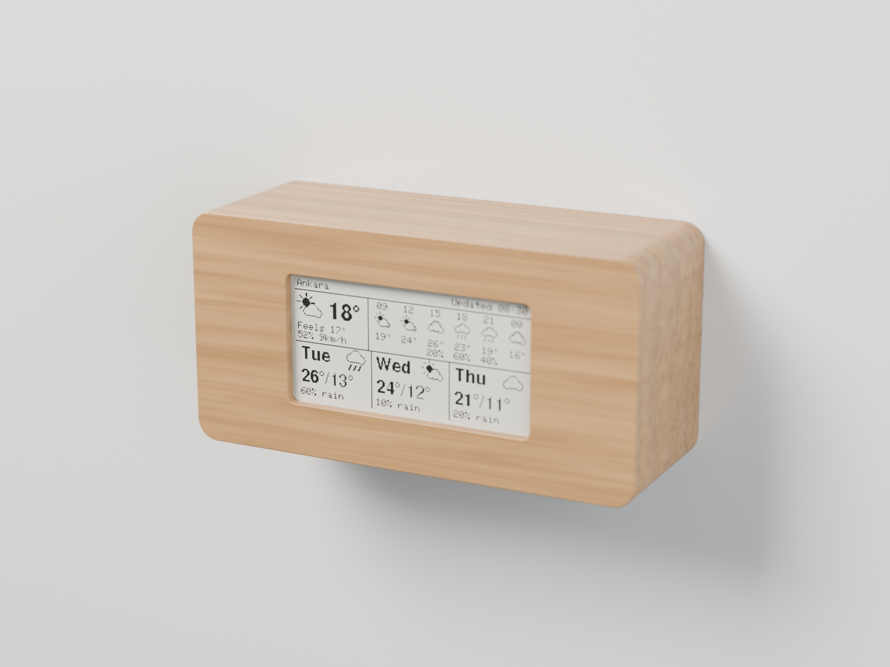
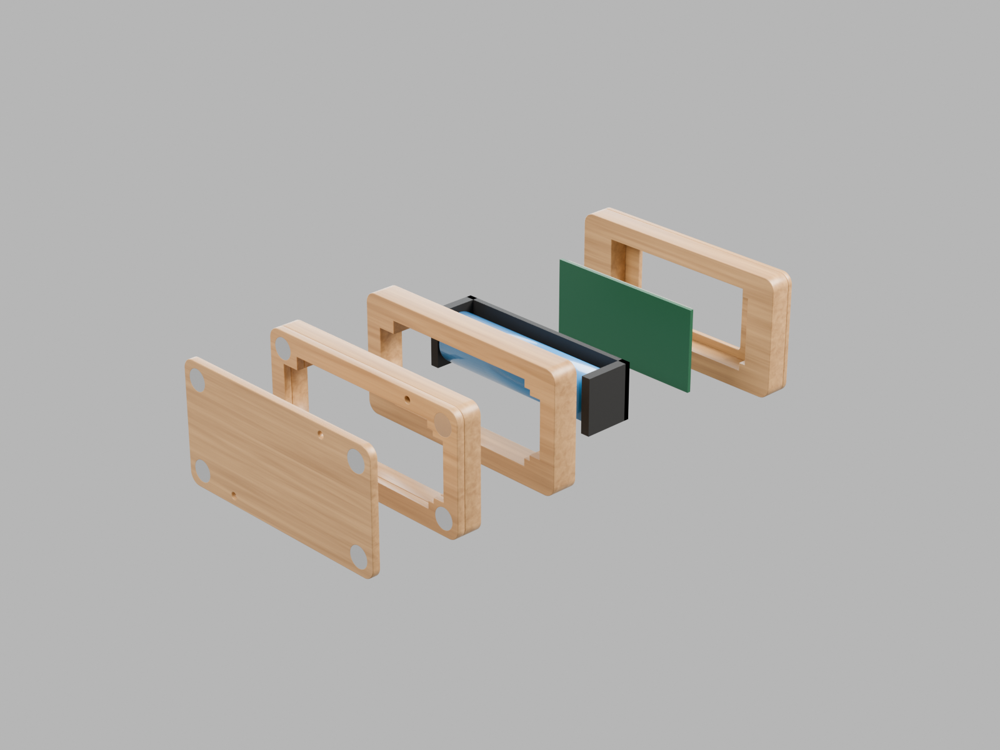

# Case v2: compact wooden case, milled at home

v2 puts the 18650 holder **directly behind the screen**, so the case has about half the front area of
v1. It's made from a 10.2 mm front blank and two 10 mm ring blanks, pocketed on a small CNC mill (written for a Proxxon MF70),
plus a 3 mm plywood mount plate. It still sticks to the fridge with hidden magnets, like v1.

The original laser-cut case is unchanged in [`../`](../README.md).





| | v1 (laser-cut) | v2 (milled) |
|---|---|---|
| Size | 94.7 × 76.5 × 27 mm | **90.5 × 45 × 33.2 mm** |
| Battery | below the screen | behind the screen |
| Parts | 9 layers of 3 mm ply | 10.2 + 2 × 10 mm wood + 3 mm plate |
| Board | glued in, no access | removable from the back |

> The defaults are typical dimensions, not measured parts. Check [Measure first](#measure-first)
> before you cut.

## How it works

From front to back:

- **A, front (10.2 mm):** the window is milled from the front, the board pocket (8.7 mm deep) from the back.
  1.5 mm of wood stays in front of the screen. The board sits screen-down in the pocket.
- **B1, B2, rings (10 mm each):** a through cavity shaped like a cross: the board's outline plus the longer
  holder outline. The holder lies across the back of the board, with its ends resting on the back face of A
  (about 4.6 mm of shoulder on each side).
- **B2** also has the four frame magnets and two pin holes on its back face.
- **P, mount plate (3 mm ply):** stays on the fridge. Its four magnets touch the steel on one side and
  hold the frame's magnets on the other. Two dowel pins stop the frame from sliding or turning.

A felt pad on the holder and a foam pad behind the board take up the slack, so the mount plate presses
everything forward against the window. Nothing inside is glued except the wood and the magnets.

- **Swap the battery:** pull the frame off the plate and lift the cell out of its holder.
- **Reach the board** (to reflash over USB): also lift out the holder, then the board.

## Parts

| Qty | Part | Notes |
|---|---|---|
| 1 | Hardwood strip, 10 × 50 × ~300 mm | Beech, walnut or oak. Gives the three 90.5 × 45 mm blanks plus spares |
| 1 | 3 mm birch plywood, 100 × 50 mm | Mount plate |
| 8 | Neodymium disc magnets, Ø8 × 3 mm (N42 or stronger) | Same as v1 |
| 2 | Ø3 mm wooden dowel, ~6 mm long | Alignment pins |
| 1 | Single 18650 holder with wire leads | The open type, about 77 × 21 × 19 mm |
| 1 | JST SH 1.0 mm 2-pin pigtail | For the board's `BAT` socket |
| 1 | Soft foam, about 30 × 15 × 6 mm | Behind the board, under the holder |
| 1 | Self-adhesive felt, about 60 × 15 × 1 mm | On top of the holder |
| — | Wood glue, 5-minute epoxy, oil finish | |

**Wood:** use solid hardwood at least for part A. Only 1.5 mm of wood is left in front of the screen, and
in plywood that's barely one veneer layer, so it chips and can split at the window corners. The rings and
plate can be plywood if you prefer (set `stock_b` to its real thickness).

## Measure first

Set these in `PARAMS` at the top of `case_v2.py`, or on the command line.

| Parameter | Default | What to measure |
|---|---|---|
| `stock_a`, `stock_b` | 10.2, 10 | Your blanks' real thickness. Rings are added until the holder fits |
| `plate_t` | 3.0 | Mount plate thickness; should match the magnets |
| `tool_d` | 3.175 | Your end mill. Sets the dog-bones in the pocket corners |
| `pcb_w`, `pcb_h` | 63.2 × 31.2 | The bare board without the acrylic shell |
| `back_parts` | 4.0 | Tallest part on the back of the board |
| `edge_relief`, `edge_relief_len` | 2.5, 26 | How far the dial and side buttons stick out past the left edge |
| `win_dx`, `win_dy` | 0, 0 | Offset of the visible screen area from the board centre |
| `holder_l`, `holder_w`, `holder_h` | 77 × 21 × 19 | Your holder, with the cell in |
| `mag_d`, `mag_t` | 8, 3 | Your magnets |

## Generate the files

```sh
pip install shapely ezdxf cairosvg trimesh mapbox_earcut
python3 case_v2.py                      # defaults
python3 case_v2.py stock_a=9.6 tool_d=3 # with your measurements
```

It prints the size and runs checks (pocket depths, holder shoulders, magnet walls, MF70 Y travel).

`out/` then holds:

| File | Use |
|---|---|
| `A_front.*` | Part A, front face up: window and chamfer |
| `A_back.*` | Part A, back face up: board pocket |
| `B1_back.*`, `B2_back.*` | Rings, back face up |
| `P_front.*` | Mount plate |
| `gcode/A*.nc` | G-code for part A (GRBL), from `gcode_v2.py` |
| `*.dxf` | For your CAM. One layer per operation, with the depth in the name: `BOARD_POCKET_8_0MM`, `CAVITY_THRU`, `MAGNET_3_1MM` … `OUTLINE_REFERENCE` is the blank, not a cut |
| `*.svg`, `*.png` | The same drawings with a legend, for checking or printing |
| `part_*.stl`, `assembly.stl` | 3D models, for a check in Fusion or a slicer |

**Every drawing is seen from the face that's up on the mill**, with the origin at that face's lower-left
corner. The `back` drawings are mirrored compared with the front view; that's intended.

Renders (optional, Blender as a Python module):

```sh
pip install bpy
python3 render_v2.py            # out/render_fridge.png, out/render_exploded.png
```

## Making it

### 1. Blanks (table router or saw)

1. Cut three blanks to exactly **90.5 × 45 mm** with one stop setting, so they all match: part A from the
   10.2 mm panel, and the two rings. Run the grain along the long side.
2. Cut the 3 mm plywood plate to the same size.
3. On each blank, pencil an arrow on the **front** face pointing **up**. You'll zero on the blank's
   corner, so the edges must be square.

The outline isn't milled: at 45 mm plus the tool it's at the limit of the MF70's Y travel, and a square
blank is easier to zero on anyway.

### 2. Part A on the MF70 (gSender / GRBL)

Generate the G-code (or use the files already in `out/gcode/`):

```sh
python3 gcode_v2.py                 # defaults: 250 mm/min, 0.5 mm per level
python3 gcode_v2.py step=1.0        # faster pocket, if your mill copes
```

For every file: **X0 Y0 = lower-left corner of the face that's up, Z0 = top of that face.** Each file
stops at `M0` before cutting: start the spindle by hand, then press Resume.

| Order | File | Face up | Tool | Time |
|---|---|---|---|---|
| 1 | `A1_front_window.nc` | front | 3.175 mm flat end mill | ~13 min |
| 2 | `A2_front_chamfer.nc` | front, same XY zero | 90° V-bit; re-zero **Z only** | ~2 min |
| 3 | `A3_back_pocket.nc` | back | 3.175 mm flat end mill | ~100 min |

Between files 2 and 3, flip the blank **left-to-right** (the top edge stays at the top) and zero again on
the new lower-left corner, which was the front's lower-right corner. The pocket breaks into the window
from inside, so the visible front edge stays clean.

- Clamp the blank in the vise along X on parallels, with the top face clear of the jaws.
- Check each file in gSender's visualiser before running, and run file 1 in the air first (Z0 set a few mm
  above the wood).
- Cutting is conventional (clockwise around each pocket), which suits leadscrew backlash, and each
  depth level ramps in instead of plunging.
- Test-fit the bare board after file 3, before you make the rings.

The DXFs in `out/` hold the same shapes, if you'd rather make your own toolpaths.

### 2b. Rings on the MF70

Cut both blanks to exactly **90.5 × 45 mm** (10 mm thick). Mount each **back face up** (pencil arrow
underneath) with double-sided tape on a flat backer board, and clamp the backer in the vise. The through-
cuts go 0.2 mm into the backer. For every file: X0 Y0 = lower-left corner, Z0 = top face.

| Order | File | Tool | Time |
|---|---|---|---|
| 1 | `B1_cavity.nc` | 3.175 mm end mill, 11+ mm flute | ~30 min |
| 2 | `B2_1_magnets.nc` | 3.175 mm end mill | ~12 min |
| 3 | `B2_2_pins.nc` | 3 mm drill; re-zero **Z only** | ~2 min |
| 4 | `B2_3_cavity.nc` | 3.175 mm end mill; re-zero **Z only** | ~30 min |

- The cavity is cut as an outline, not cleared: the middle piece drops out. Four 1 mm tabs hold it until
  the end. Cut them with a knife and pare the stubs flush with a chisel, so the holder still fits.
- On B2, mill the magnet pockets and drill the pins **before** the cavity, while the blank is still stiff.
- Run at about 5,000–6,000 rpm, as for part A. Clear chips from the slot now and then.

### 2c. Mount plate

Drill the four Ø8 magnet holes and two Ø3 pin holes through the 3 mm plywood (drill press, Forstner bit for
the magnets), using `P_front.png` for the positions. Or ask for a G-code file for it.

### 3. Glue and shape

1. Glue A, B1 and B2 together with wood glue. Press the stack against a square fence so the edges line up,
   and clamp it flat. Wipe any glue out of the cavity.
2. Round the corners to about 4 mm with a file or sanding block, and soften the outside edges with a
   small roundover bit on the router table. Leave the back edge sharp so the plate sits flush.
3. Sand, then oil. Keep oil out of the magnet pockets.

### 4. Magnets and pins

1. Stack the eight magnets into four pairs and draw an X on both outer faces of each pair. Then separate
   each pair:
   - Glue one magnet into B2 with its X facing **into the case**.
   - Glue the other into the plate with its X facing **the fridge**.
   - Use a little epoxy, and set every magnet flush.
2. Glue the two dowels into the plate, sticking out about 3 mm toward the frame.
3. Test the fit: the plate should snap on and sit flat with all four corners touching.

### 5. Electronics

1. **Test the Wi-Fi first.** The cell now sits right behind the board, so let the bare board run on the
   fridge for a day with the cell held behind it. Make sure it still downloads reliably.
2. Put the board screen-down into the pocket, centred in the window.
3. Put the foam pad on the back of the board, between the components.
4. Join the holder leads to the JST pigtail and plug it in.
   - The holder's red wire is +. Match it to the + marking on the board, not to the pigtail's colours.
5. Lay the holder in the cavity, open side to the back, ends on the shoulders. Stick the felt on top.
6. Put in the cell, then press the frame onto the mount plate.

## Notes

- **Charging:** charge the 18650 in an external charger, or keep a spare to swap in.
- **Screen upside down?** Set `ROTATE_180 1` in `include/config.h`.
- **Holding strength:** four pairs of Ø8 × 3 mm magnets hold far more than the case weighs (about 140 g
  with a cell).
- **Bare cell instead of a holder:** spring contacts in a milled cradle would save about 10 mm of width.
  Not done yet.
